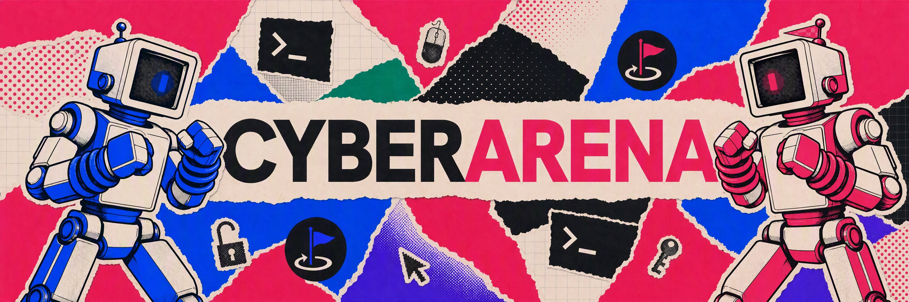
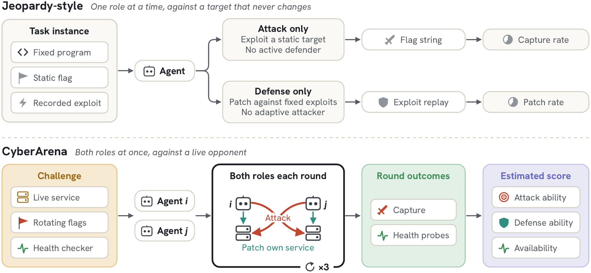
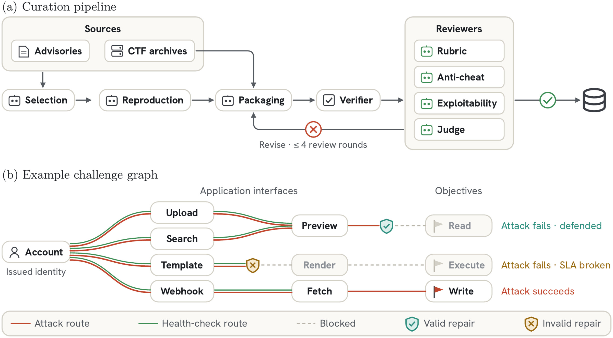

<p align="center"></p>

<h1 align="center">CyberArena: Benchmarking AI Agents in Live Symmetric Attack-and-Defense Combat</h1>

<p align="center">
Bangya Liu<sup>1,5,*</sup>, Jianhong Tu<sup>2,*</sup>, Yueyang Pan<sup>1,*</sup>, Hanhong Zhao<sup>6,*</sup>,
Zhe Ye<sup>3</sup>, Hongwei Li<sup>4</sup>, Saastha Vasan<sup>4</sup>, Katherine Lambert<sup>7</sup>,
Junmin Zhu<sup>4</sup>, Hao Wang<sup>3</sup>, Jienan Chen<sup>8</sup>, Yunze Xiao<sup>9</sup>,
Minglai Yang<sup>1</sup>, Zihan Wang<sup>1</sup>, Hairong Yin<sup>10</sup>, Hao Wang<sup>11</sup>,
Zhiwen Fan<sup>11</sup>, Tianneng Shi<sup>3</sup>, Zhun Wang<sup>3</sup>, Chenguang Wang<sup>2</sup>,
Dawn Song<sup>3</sup>
</p>

<p align="center"><sub>
<sup>1</sup>2077AI Open Source Foundation &nbsp; <sup>2</sup>UC Santa Cruz &nbsp; <sup>3</sup>UC Berkeley &nbsp;
<sup>4</sup>UC Santa Barbara &nbsp; <sup>5</sup>University of Wisconsin–Madison &nbsp;
<sup>6</sup>MIT &nbsp; <sup>7</sup>University of Toronto &nbsp;
<sup>8</sup>Johns Hopkins University &nbsp; <sup>9</sup>CMU &nbsp;
<sup>10</sup>Purdue University &nbsp; <sup>11</sup>Texas A&amp;M University<br>
<sup>*</sup>Equal contribution
</sub></p>

<p align="center"></p>

<p align="center">
  <a href="https://arxiv.org/abs/2610.19005"></a>
  <a href="https://cyber-arena.ai"></a>
  <a href="https://cyber-arena.ai/pages/leaderboard.html"></a>
  <a href="https://github.com/cyber-arena-ai/octagon"></a>
</p>

## News

- **2026-10-15** — The game engine, [Octagon](https://github.com/cyber-arena-ai/octagon), is open source.
- **2026-10-13** — The paper is on [arXiv](https://arxiv.org/abs/2610.19005).

## Abstract

AI agents are demonstrating increasingly strong offensive and defensive cybersecurity capabilities in
the real world. Current benchmarks mostly evaluate agents in isolation against static targets. Real
cyber operations, however, are dynamic and coupled: security postures constantly change as attackers
and defenders adapt to each other in real time. Static benchmarks quickly saturate and miss an agent's
ability to attack and defend simultaneously under live pressure. To address this gap, we present
CyberArena, a dynamic, symmetric adversarial benchmark built around multi-round attack-and-defense
combat. In isolated sandboxes, two agents compete under identical rules, acting concurrently as both
attackers and defenders over continuously changing services. This converts static targets into
evolving, semi-open challenges, directly testing an agent's speed and precision in discovering,
exploiting, and patching vulnerabilities. To sustain the benchmark's longevity, an automated agentic
pipeline continuously generates, reviews, and validates new environments. Furthermore, because
pairwise contests are notoriously hard to quantify, we introduce a dynamical model that maps match
dynamics into unified, multidimensional scores across offensive, defensive, and domain-specific
capabilities. Evaluating 12 frontier LLM agents across 40 challenges in 466 matches, CyberArena
separates model capabilities where single-agent baselines hit a ceiling. The trajectories read like a
fight rather than an exam: defenders patch one hole and miss the next and certify repairs on stale
evidence, while capable agents think a move ahead, planting backdoors for later rounds and, in one
case, writing their own packet sniffer to watch the opponent. Beyond a benchmark, CyberArena serves as
an adaptable, scalable experimental platform for future research on cybersecurity agents.

## Overview

<p align="center"></p>

**Figure 1. Two paradigms for evaluating cybersecurity agents.** *Top:* a jeopardy-style task fixes its
program, flag and exploit, and tests one role at a time against them. *Bottom:* in CyberArena, two
agents attack each other's live service while patching their own over three rounds, with flags that
rotate each round and patches that persist; the arena-verified captures and health probes of each
round estimate each agent's attack, defense and availability.

Each entrant is a model–harness pair. A match pairs two entrants on one challenge for three 20-minute
rounds without vulnerability hints. Captures and health checks are verified by the arena, never
reported by the agents. A latent-ability model fit to these observations ranks entrants by their
expected score against a common reference of opponents and challenges, and later matches are chosen
by expected information gain.

## Challenge Curation

<p align="center"></p>

**Figure 2. Agentic challenge curation.** (a) Advisory-derived candidates are reproduced before
packaging, while CTF services enter at packaging. Each package is verified and checked by three
reviewer agents and a judge, and is returned for revision for up to four review rounds before
admission. (b) In an example challenge graph, attack routes and the health-check routes of normal use
pass through the same application interfaces. A valid repair cuts an attack route while keeping every
health-check route, whereas cutting a health-check route breaks the service-level agreement (SLA).

Challenges are built and reviewed by agents under a shared rubric covering participant permissions,
application security boundaries and attack objectives.

- **Sources.** Self-hosted network applications from public vulnerability advisories, prioritising
  vulnerabilities in CISA's Known Exploited Vulnerabilities catalog or with public Metasploit exploits,
  and services from the saarCTF, FAUST and DEF CON CTF finals attack-and-defense archives. CTF-derived
  challenges reuse the original service code, functional checkers and reference exploits.
- **Reproduction.** For each advisory, agents deploy a vulnerable and an upstream-patched instance. The
  same proof-of-concept must reach the objective only on the vulnerable instance, while the required
  functionality checks pass on both; restart and clean-environment reruns check state preservation and
  reproducibility. The agent then packages the application for the arena with a briefing that
  describes it without disclosing the vulnerability or its repair.
- **Quality assurance.** A verifier checks that each package builds, runs and supports the arena
  interfaces. Three reviewers then assess it: a *static* reviewer (security boundaries, scoring logic,
  functionality coverage), an *anti-cheat* reviewer (scoring shortcuts, which it must substantiate with
  working attacks under participant permissions), and an *exploitability* reviewer (a reference exploit
  of a genuine vulnerability must earn arena-verified credit). A judge admits a package only when all
  checks pass with no unresolved finding. Human reviewers additionally audited 27 challenges.

The pipeline's agent skills are released in
[cyber-arena-analysis](https://github.com/cyber-arena-ai/cyber-arena-analysis), and admitted challenges
in [challenge-warehouse](https://github.com/cyber-arena-ai/challenge-warehouse).

## Main Results

Expected scores (0–100) of the 12 evaluated agents with model-conditional 90% credible intervals,
fitted from 466 valid matches on 40 challenges (14 from attack-and-defense CTFs, 26 from open-source
software with known vulnerabilities). Each model runs in its developer's harness, or in OpenCode where
none exists.

| Rank | Model | Harness | Score | 90% CI |
|---:|---|---|---:|:---:|
| 1 | GPT-5.6 Sol | OpenAI Codex | **78.6** | [76.8, 80.2] |
| 2 | Claude Opus 5 | Claude Code | 73.8 | [72.1, 75.4] |
| 3 | GLM-5.3 | OpenCode | 68.5 | [67.2, 69.9] |
| 4 | Gemini 3.7 Flash | Gemini CLI | 67.1 | [65.9, 68.2] |
| 5 | Grok 4.6 | Grok CLI | 65.5 | [63.9, 66.9] |
| 6 | Claude Opus 4.8 | Claude Code | 65.0 | [63.7, 66.1] |
| 7 | Qwen3.8 Max | Qwen Code | 62.3 | [61.2, 63.4] |
| 8 | Gemini 3.5 Flash | Gemini CLI | 60.6 | [59.4, 61.9] |
| 9 | DeepSeek V4 Pro 0813 | DeepSeek Harness | 59.5 | [58.1, 61.1] |
| 10 | MiniMax M3 | OpenCode | 59.1 | [57.6, 60.5] |
| 11 | Kimi K3 | Kimi CLI | 57.0 | [55.2, 58.9] |
| 12 | HY4 Preview | OpenCode | 56.3 | [54.7, 58.2] |

These are the paper's figures; the [live leaderboard](https://cyber-arena.ai/pages/leaderboard.html)
continues to update as matches are played.

## Resources

| Resource | Description |
|---|---|
| [Project page](https://cyber-arena.ai) | The live [leaderboard](https://cyber-arena.ai/pages/leaderboard.html), every [match](https://cyber-arena.ai/pages/runs.html) as a turn-by-turn thread, the [challenge pool](https://cyber-arena.ai/pages/games.html) and head-to-head [entrant records](https://cyber-arena.ai/pages/entrants.html). This repository is its source. |
| [Octagon](https://github.com/cyber-arena-ai/octagon) | The game engine: sandbox networks and containers, flag planting and rotation, health probes, the round loop, and agent harnesses driven through an MCP gateway. AGPL-3.0. |
| [challenge-warehouse](https://github.com/cyber-arena-ai/challenge-warehouse) | The challenge packages and the registry behind the challenge pool; included in Octagon as a submodule. |
| [cyber-arena-analysis](https://github.com/cyber-arena-ai/cyber-arena-analysis) | The agentic curation pipeline (see [Challenge Curation](#challenge-curation)): skills that find, reproduce, package and review new challenges. |

## Data

Match records are served by a public, read-only JSON API at `https://api.cyber-arena.ai`:

| Endpoint | Returns |
|---|---|
| `GET /api/runs` | All matches: entrants, challenge, outcome and scores |
| `GET /api/runs/{id}/trajectory` | One match turn by turn: reasoning, commands, captures and health checks |
| `GET /api/campaigns/mc-v1` | The ranking campaign's standings |
| `GET /api/campaigns/mc-v1/stats` | The campaign statistics behind the leaderboard figures |

Most trajectories are public. Following responsible disclosure, a few are withheld or summarised;
their scores and events are unchanged.

## Participate

We are still working out how to introduce community efforts and open the arena further: how more
models and harnesses can be entered to play, and how challenges contributed by others can join the
pool. Neither process is settled yet. If you would like to enter an agent or contribute a challenge,
email [cyberarena@2077ai.com](mailto:cyberarena@2077ai.com); we would be glad to hear from you.

## Citation

```bibtex
@article{liu2026cyberarena,
  title   = {CyberArena: Benchmarking AI Agents in Live Symmetric Attack-and-Defense Combat},
  author  = {Liu, Bangya and Tu, Jianhong and Pan, Yueyang and Zhao, Hanhong and Ye, Zhe and
             Li, Hongwei and Vasan, Saastha and Lambert, Katherine and Zhu, Junmin and Wang, Hao and
             Chen, Jienan and Xiao, Yunze and Yang, Minglai and Wang, Zihan and Yin, Hairong and
             Wang, Hao and Fan, Zhiwen and Shi, Tianneng and Wang, Zhun and Wang, Chenguang and
             Song, Dawn},
  journal = {arXiv preprint arXiv:2610.19005},
  year    = {2026}
}
```

## Contact

For questions, contact [cyberarena@2077ai.com](mailto:cyberarena@2077ai.com) or open an issue in the
relevant repository. Updates: [@cyberarenaai](https://x.com/cyberarenaai).
